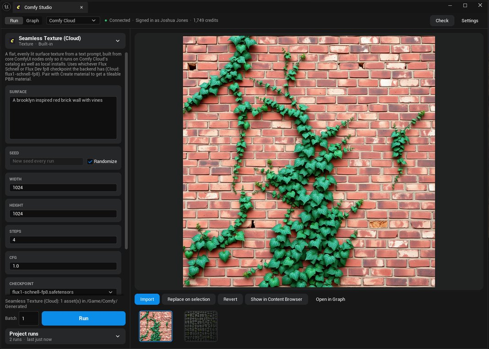
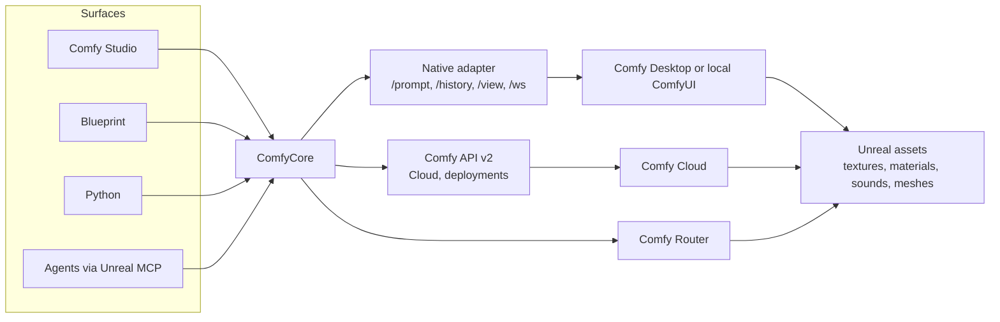

<div align="center">


# Comfy for Unreal

An Unreal Engine plugin that lets artists, Blueprints, Python and AI agents run ComfyUI workflows from inside the editor, on Comfy Desktop, Comfy Cloud or Comfy Router, and get real Unreal assets back.

Unreal Engine 5.8 · Win64 · v0.1.0 alpha


</div>

> **Alpha.** Built and tested on one PC between October 22 and 25, 2026, for an internal alpha ahead of Epic's 2026 AI MegaJam.
> **Tested end to end:** the texture pad Blueprint on Comfy Cloud (a trigger runs a workflow and the texture lands on a cube at runtime), the Run view on Comfy Cloud through the sign-in, the Graph view, and **Send to Unreal** from a local ComfyUI.
> **Not yet tested:** each starter workflow on both Comfy Cloud and Comfy Desktop, the Blueprint node with one pin per input, image inputs from Blueprint, the Desktop backend from Blueprint, **Send to Unreal** from the Comfy Cloud page, and installing the prebuilt zip on a clean machine.

| | |
| --- | --- |
| **What it is** | Comfy Studio, a tab in the Unreal Editor with ComfyUI's App mode layout and the ComfyUI graph itself, plus a public API for Blueprints, Python and agents. Workflows go in; textures, materials, sound waves and static meshes come out as assets. |
| **Who it's for** | MegaJam teams who need placeholder art and sound fast on a laptop. Technical artists who build a studio's workflows once and hand the team a form. AI agents that drive the editor through Epic's Unreal MCP. |
| **How it's different** | It runs any ComfyUI workflow you export, not a fixed list of models. The same workflow runs on your own GPU or on Comfy Cloud without edits. Agents get it through Epic's own MCP toolset registry, with no extra server. |

## Contents

- [01 · Quick start](#01--quick-start)
- [02 · Comfy Inputs](#02--comfy-inputs)
- [03 · Backends](#03--backends)
- [04 · In the editor](#04--in-the-editor)
- [05 · Starter workflows](#05--starter-workflows)
- [06 · Blueprint and Python](#06--blueprint-and-python)
- [07 · Agents](#07--agents)
- [08 · The ComfyUI extension](#08--the-comfyui-extension)
- [09 · Architecture](#09--architecture)
- [10 · Quality bar](#10--quality-bar)
- [11 · Roadmap](#11--roadmap)
- [12 · Troubleshooting](#12--troubleshooting)
- [Building from source](#building-from-source)
- [Contributing and feedback](#contributing-and-feedback)
- [License](#license)
- [Acknowledgements](#acknowledgements)

## 01 · Quick start

| Step | What to do |
| --- | --- |
| Requirements | Unreal Engine 5.8 on Windows (Win64). One backend: Comfy Desktop or another local ComfyUI, or a Comfy account for Comfy Cloud. |
| Install | Copy the plugin folder to `YourProject/Plugins/ComfyUnreal` and enable **Comfy for Unreal**. It also enables Epic's ToolsetRegistry and Python Editor Script plugins. |
| Open Comfy Studio | Click the Comfy button in the level toolbar, or **Tools > Comfy Studio**. |
| Connect a backend | Pick a backend in the status line. **Desktop** finds a running local ComfyUI. **Comfy Cloud** asks you to sign in, in the Graph view; no API key is needed. |
| First run | In the Run view, pick **Seamless Texture**, type a surface such as `mossy cobblestone path`, and press **Run**. The texture imports to `/Game/Comfy/Generated`. |

The full guide for testers is [docs/user/get-started.mdx](docs/user/get-started.mdx). It covers install, connecting each backend, running, using results and troubleshooting.

## 02 · Comfy Inputs

**Comfy Inputs** is a Blueprint variable type that holds a workflow and values for its inputs, like a saved App mode form. One generic node, **Run Comfy Workflow**, runs it. You don't generate a node per workflow, and there is nothing to regenerate when the workflow changes.

| Feature | What it does |
| --- | --- |
| A workflow plus values | The variable names its workflow, so it knows the inputs. Connect it to the node's **Inputs** pin and leave the node's **Workflow** pin empty; the node runs the variable's workflow. |
| A form in the Details panel | Pick a workflow in the variable's Default Value and the Details panel lists its inputs, as the Run view does: a text box per prompt, number fields, checkboxes, dropdowns for choices and models, and a texture picker for image inputs. Each row has a reset arrow, and every change can be undone. |
| Values per actor | Make the variable **Instance Editable** and each placed actor shows the same form, so a designer can give each actor its own prompt without opening the Blueprint. |
| Name checks | A name the workflow doesn't have shows as a red row with a **Remove** button. At run time, a misspelled name or a value of the wrong type fails the run before anything is sent: `Seamless Texture has no input named "promt"`, then the list of its inputs. |
| Defaults stay | An input left out keeps the workflow's own value. Seeds are the exception: an unset seed gets a new seed on every run. |
| Changed at runtime | **Set Text**, **Set Int**, **Set Float**, **Set Bool**, **Set Seed**, **Set File**, **Set Texture** and **Set Asset** (Comfy Inputs) each return the inputs with one value changed, so they chain without exec wires. **Get Comfy Input** and **Clear Comfy Input** read and remove one value. |

The texture pad from the tutorial, as wired in the test on Comfy Cloud:

```text
Trigger: On Component Begin Overlap
  -> Cast To Character
  -> Branch (NOT IsGenerating) -> Set IsGenerating = true
  -> Set Text (Comfy Inputs)  [Inputs: PadInputs, Name: "prompt", Value: Random Array Item of Prompts]
  -> Run Comfy Workflow       [Workflow: empty, Inputs: from Set Text, Backend: Active backend]
       On Completed -> Load Texture From Job [Job]
                    -> Set Texture Parameter Value [CubeMaterial, "BaseColor"]
                    -> Set IsGenerating = false
       On Failed    -> Print String [Job > Error Message] -> Set IsGenerating = false
```

Step-by-step: [docs/user/tutorial-texture-pad.mdx](docs/user/tutorial-texture-pad.mdx).

### Where input definitions come from

A Comfy Workflow asset is a ComfyUI `Export (API)` graph plus a manifest, stored in `workflow.extra.comfy_unreal` and specified in [docs/MANIFEST.md](docs/MANIFEST.md). When a graph comes in, the plugin uses the first of these that exists:

| Source | What it gives |
| --- | --- |
| The manifest | Inputs a workflow author exposed with the ComfyUI extension (section 08), or that a starter workflow lists: label, type, node, widget, tooltip, preferred models. |
| ComfyUI App mode | The inputs chosen in ComfyUI's App mode (`extra.linearData`). |
| Detection | Load Image, Audio and Video nodes become file inputs; Save and Preview nodes become outputs. Widgets with well-known names become inputs: text and prompt fields, seed, steps, cfg, denoise, width, height, batch size, seconds, duration, length, and the checkpoint, UNet and LoRA loaders. Other widgets keep the value saved in the graph. |

### Input types

| Type | In the form and on the node |
| --- | --- |
| String, Text | A text box. Text is multi-line, for prompts. |
| Int | A whole number. |
| Float | A number. |
| Bool | A checkbox. |
| Seed | A whole number; `-1` or unset means a new seed every run. |
| File | An image, audio or mesh file. Image inputs take a texture or render target; others take a path. |
| Enum | A dropdown of the input's choices. |
| Model | A dropdown of model files from the connected backend. Empty means **Auto**. |

**Model inputs travel between machines.** A Model input lists the files the connected backend has and picks the first match from the manifest's `prefer` list, exact filename first, then substring. `family` says what kind of model fits, for example `flux-vae`. When the backend has none of the preferred files, the run stops before anything is sent and names the missing file; a `download` block in the manifest adds a **Download** button.

**Source** tells the Run view where to fill an input from: `Constant` (the form), `Prompt` (the main text box), `SelectedTextures`, `SelectedMeshes` or `ViewportCapture`.

## 03 · Backends

Backends are named profiles in **Project Settings > Plugins > Comfy**, with one active per user. The Run nodes' **Backend** pin chooses **Active backend**, **Desktop**, **Comfy Cloud** or **Comfy Router**. Each choice uses the profile of that kind, so the same Blueprint runs on any machine.

| Backend | Connects to | Sign-in | Custom nodes | Cost |
| --- | --- | --- | --- | --- |
| Desktop | Comfy Desktop, portable ComfyUI or any local install, through its native routes (`/prompt`, `/history`, `/view`, `/ws`). Default `http://127.0.0.1:8188`; Studio also tries 8000, 8188 and the ports in Comfy Desktop's installations. | None | Whatever that install has | Free; uses your GPU |
| Comfy Cloud | `https://cloud.comfy.org`, Comfy API v2 | Sign in from the Graph view, or an API key | None; Cloud loads no custom nodes | Comfy Credits; free runs shown in the status line |
| API deployment | `{deployment}.run.comfy.app`, Comfy API v2, built with `comfy build` and `comfy deploy` | API key | What the deployment was built with | Credits, billed while running. Not tested. |
| Comfy Router | `https://api.comfy.org`, single partner-model calls, no workflow graph | API key | Not applicable | Credits |

**Keys never go in project config.** The plugin reads a key from the profile's environment variable (`COMFY_API_KEY` by default), then `COMFY_CLOUD_API_KEY` (comfy-cli's workspace key), then a key set for the session, then **Editor Preferences > Plugins > Comfy**. A key the server refuses is remembered by its hash and skipped until it changes. On Comfy Cloud, Studio then runs with the sign-in.

**Signing in to Comfy Cloud.** Studio injects a small bridge script, `Resources/Bridge/comfy_unreal_page.js`, into the Cloud page. Unreal's calls run inside the page with the page's own sign-in, so the session token never leaves the page and nothing is stored in the project or logs. The status line shows the account, free runs and credits. This depends on Comfy Cloud frontend internals and has not yet been reviewed by the Comfy Cloud team.

## 04 · In the editor

Comfy Studio is one tab with a status line and two views.



*The Run view on October 24, after a Comfy Cloud run through the sign-in. This shot predates the current starter workflows.*

| View or area | What it does |
| --- | --- |
| Status line | The Run and Graph switch, the backend picker, a connection dot with a summary (on Cloud, the account and credits), the running-jobs count, Check or Retry, and Settings. |
| Run view | Laid out like ComfyUI's App mode. Pick a workflow from the library ("What do you want to make?") or the picker. Each input is a card built from the workflow. Presets fill the form with a working example. A model card says when the backend lacks a file. |
| In Unreal options | Import results when they finish, make a material from images, make it tileable with a derived normal map, and the destination folder. |
| Gallery and actions | A large preview and a strip of results with progress. **Import**, **Replace on selection** (puts the material on every slot of the selected actors), **Revert**, **Show in Content Browser** and **Open in Graph**. Sounds play in place. |
| Project runs | Every run is kept as `job.json` beside its outputs in `Saved/Comfy/Jobs` and listed newest first. Opening one shows the result and puts its workflow and inputs back in the form. |
| Graph view | The active backend's ComfyUI frontend in Unreal's embedded browser. **Send to Unreal** saves the open graph as a Comfy Workflow asset. Sign-ins persist in `Saved/Comfy/Browser`. |

Every imported asset carries its provenance: the workflow, inputs, seed, backend and job that made it. Assigning a material can be undone with **Revert** or Ctrl+Z.

## 05 · Starter workflows

Six starters ship with the plugin. Each uses ComfyUI core nodes only and models that are all on Comfy Cloud, so the same file runs on Cloud and on a local ComfyUI. The editor saves each one as an asset in the plugin's `Content/Workflows` folder (`/ComfyUnreal/Workflows`), so Blueprints can reference them.

| Starter | Asset | Makes | Model | Local download |
| --- | --- | --- | --- | --- |
| Seamless Texture | `texture_seamless` | A surface texture from a prompt | FLUX.2 Klein 4B | about 11.6 GB (3 files) |
| Texture Restyle | `texture_restyle` | A changed copy of a selected texture | FLUX.2 Klein 4B edit | same files |
| Texture Upscale | `texture_upscale` | A larger copy of a selected texture | Real-ESRGAN x4 | 67 MB |
| Sound Effect | `audio_sound_effect` | A sound effect or ambience, up to 47 s | Stable Audio Open 1.0 | 5.8 GB (2 files) |
| Music Track | `audio_music` | A music track, instrumental by default | ACE-Step 1.5 turbo | 10 GB |
| Image to Mesh | `mesh_image_to_mesh` | An untextured static mesh from one image | Hunyuan3D 2.0 | 4.9 GB |

Comfy Cloud has every model. On a local ComfyUI without a file, the model card names it and offers **Download**, and Run stops before sending anything.

All six were validated offline against Comfy Cloud's node specs (node classes, required inputs, link types, combo values and model names). Only Seamless Texture has run end to end, on Comfy Cloud. The JSON in `Resources/Workflows` is generated: edit [tools/build_starter_workflows.py](tools/build_starter_workflows.py) and run `python tools/build_starter_workflows.py`.

## 06 · Blueprint and Python

| Node or function | What it does |
| --- | --- |
| **Run Comfy Workflow** | An async node with **On Progress**, **On Completed** and **On Failed**, each passing the **Job**. Set its **Workflow** pin and it grows one typed pin per input; leave it empty and connect a Comfy Inputs instead. The right-click menu has one **Run &lt;workflow&gt;** entry per workflow asset, such as **Run Seamless Texture**. Each places the same node with **Workflow** set. |
| **Backend** pin | **Active backend** (the one selected in Studio), **Desktop**, **Comfy Cloud** or **Comfy Router**. |
| **Load Texture From Job**, **Load Sound From Job** | Load a result at runtime, with no editor needed. Leave the output name empty to take the first result of that kind. |
| **Run Comfy Workflow (String Map)** | The older node, which takes a map of strings. Kept unchanged. |
| **Run Comfy Router Model** | Calls one partner model through Comfy Router. Spends credits. |
| Editor functions | **Import Job Outputs**, **Create Material From Job**, **Assign Material To Selected Actors**, **Capture Active Viewport**, **Get Provenance** and **Open Studio**, for Editor Utility Blueprints. |

The node compiles to plain runtime calls, so a packaged game needs only the ComfyCore module. For a shipped game, keep API keys on your own server, not in the client.

**Python.** The subsystem and libraries are reflected to Python automatically:

```python
import unreal

comfy = unreal.get_engine_subsystem(unreal.ComfySubsystem)
workflow = unreal.ComfyEditorLibrary.find_workflow("texture_seamless")
job = comfy.run_workflow(workflow, {"prompt": "weathered red brick"}, "Comfy Cloud")
```

`run_workflow` takes the workflow asset, a map of input names to values, and a backend profile name (`None` uses the active backend). It returns a `ComfyJob`.

**C++:**

```cpp
UComfyJob* Job = UComfySubsystem::Get()->RunWorkflow(Workflow, { { TEXT("prompt"), TEXT("mossy cobblestone") } });
Job->OnFinishedNative.AddLambda([](UComfyJob* Done)
{
	if (Done->Succeeded())
	{
		UTexture2D* Texture = UComfyRuntimeLibrary::LoadTextureFromJob(Done, TEXT("albedo"));
	}
});
```

## 07 · Agents

The ComfyAgent module registers `ComfyAgent.ComfyToolset` with Epic's ToolsetRegistry. Unreal MCP's `list_toolsets`, `describe_toolset` and `call_tool` expose it, with no extra server.

| Group | Tools |
| --- | --- |
| Backends | `ListBackends`, `CheckBackend`, `SetActiveBackend` |
| Workflows | `ListWorkflows`, `DescribeWorkflow`, `ImportWorkflow` |
| Jobs | `RunWorkflow`, `WaitForJob`, `GetJob`, `ListJobs`, `CancelJob` |
| Results | `ImportJobOutputs`, `CreateMaterialFromJob`, `GenerateMaterial` |
| Comfy Router | `ListRouterModels`, `DescribeRouterModel`, `RunRouterModel` |
| Editor | `OpenStudio` |

These 18 tools follow these conventions:

- Tool names are PascalCase, the C++ function names. Parameters are camelCase as the registry exposes them, and every parameter is required (pass `""` for an empty string).
- Every tool returns `{"returnValue": "<JSON>"}`. Long-running tools (`CheckBackend`, `WaitForJob`, `GenerateMaterial`, `ListRouterModels`, `DescribeRouterModel`) finish when the work does.
- `DescribeWorkflow` returns the inputs as JSON Schema, with model choices as enums.
- A run that would spend credits is refused until the agent passes `bAllowCreditSpend: true`, so the agent has to ask the user first.

One call from prompt to an assigned material:

```json
{
  "toolset_name": "ComfyAgent.ComfyToolset",
  "tool_name": "GenerateMaterial",
  "arguments": { "prompt": "weathered red brick", "workflow": "", "bAssignToSelection": true, "bAllowCreditSpend": false }
}
```

## 08 · The ComfyUI extension

**Comfy for Unreal** is a separate ComfyUI custom node pack, licensed GPL-3.0, in its own repository. It has no compute nodes. It lets a workflow author:

- mark which inputs Unreal may set (**Comfy for Unreal > Expose input to Unreal**), with a label, type and source;
- tag what each output becomes (**Tag output for Unreal**): a texture slot such as Base Color, Normal or ORM, or an image, sound, music or mesh;
- send the workflow to Unreal with a name, type, description, group and thumbnail, and keep a library of tagged workflows on the ComfyUI server.

The tags live in `workflow.extra.comfy_unreal`, the same manifest the plugin reads. Because the pack adds tags and no nodes, a tagged workflow still runs unchanged on Comfy Cloud, even though Cloud can't load the extension.

The design follows NVIDIA RTX Remix 1.6, which tags ComfyUI workflows for its toolkit the same way.

| State | Notes |
| --- | --- |
| Built | The extension's code is in its own repository and has no public remote yet. |
| Not yet loaded in a test | Linked into Comfy Desktop's `custom_nodes`; it loads the next time that ComfyUI starts. |
| Comfy Cloud | Cloud loads no custom nodes. Injecting the extension's frontend into the Cloud page is proposed, not built. |

## 09 · Architecture

| Module | Type | What's in it |
| --- | --- | --- |
| ComfyCore | Runtime | Settings, the workflow asset, jobs and run history, the backends (native, API v2, Router, Cloud page bridge), the subsystem, Comfy Inputs and the async actions, runtime loaders, image helpers, provenance |
| ComfyBlueprint | UncookedOnly | The Run Comfy Workflow node: one pin per workflow input, compiled to Comfy Inputs calls |
| ComfyEditor | Editor | Comfy Studio (Run and Graph views), the workflow importer, output import, the PBR material builder, the Comfy Inputs Details form, pin dropdowns, starter assets |
| ComfyAgent | Editor | `UComfyToolset`, registered with the ToolsetRegistry for Unreal MCP |



| Folder | What's in it |
| --- | --- |
| `Resources/Workflows` | Starter workflow JSON, generated by `tools/build_starter_workflows.py` |
| `Content/Workflows` | The starters saved as Comfy Workflow assets |
| `Resources/Bridge` | The script Studio injects into the Comfy Cloud page |
| `docs/user` | Tester docs (Mintlify MDX) |
| `docs/design` | The design doc; `build.py` turns the template into the self-contained `comfy-for-unreal.html` |

The API outline is in [docs/SPEC.md](docs/SPEC.md), and the design, journeys and decisions are in [docs/design/comfy-for-unreal.html](docs/design/comfy-for-unreal.html).

## 10 · Quality bar

| Bar | State | Notes |
| --- | --- | --- |
| Runs any workflow on any machine | Partial | Any `Export (API)` graph imports. A workflow with custom nodes runs only where they're installed, and Comfy Cloud has none. Detection covers a fixed list of widget names. Win64 only. |
| Fails loudly | Partial | Name and type checks and the missing-model check stop a run before sending, with a message. Clear messages for out of credits (402) and missing node classes are still to build. |
| Never blocks the editor | Built | Jobs run in the background with progress events. Not measured under load. |
| Undo | Built | **Revert** and Ctrl+Z after **Replace on selection**; undo in the Comfy Inputs form. |
| Never spends silently | Partial | Credits show in the status line. Agent tools refuse to spend without `bAllowCreditSpend`. A cost estimate before Run is still to build, and Blueprint and Python runs don't ask. |
| Never leaks keys | Built | Keys are never written to project config. The Cloud sign-in token stays in the page. |
| Doesn't fight your machine | Built | Studio finds a running ComfyUI on known ports and never starts or stops it. |
| Tested | Partial | Manual tests on one PC (see the status note). No automated tests yet; mock-backend tests are planned. |
| Documented | Draft | [Get started](docs/user/get-started.mdx), the [tutorial](docs/user/tutorial-texture-pad.mdx), [SPEC](docs/SPEC.md) and the [design doc](docs/design/comfy-for-unreal.html). Screenshots for the docs are still to take. |

## 11 · Roadmap

| When | Milestone | Scope |
| --- | --- | --- |
| Oct 26 – 31 | Alpha | Install on a clean machine, run every starter on Comfy Cloud and Comfy Desktop, Cloud bridge failure cases, a feedback channel. |
| Nov 1 – 7 | Alpha fixes | Tester fixes, save from the Cloud page, an extension install route, cost before Run, a sample project. |
| Nov 8 – 11 | Beta | A release of the plugin and the extension, docs and a short video. |
| Nov 12 on | The jam | Support and daily fixes during Epic's 2026 AI MegaJam. |
| December | v1.0 | Fab and ComfyUI Manager listings, macOS and Linux, Sequencer and Movie Render Queue. |

Also planned: typed output pins on the Blueprint node, in-game loading of the audio starters' FLAC output, textured and rigged meshes.

## 12 · Troubleshooting

| Problem | Try this |
| --- | --- |
| Desktop can't find ComfyUI | Start ComfyUI first. Studio tries the `Desktop` profile's URL, then ports 8000 and 8188, then the ports in Comfy Desktop's installations. A portable install started with `--port 8189`, or a Windows `netsh interface portproxy` rule that holds a port, needs the profile's URL set in **Project Settings > Plugins > Comfy**. Check with `netsh interface portproxy show all` and `netstat -ano \| findstr LISTENING`. A project can override the whole list in `Config/DefaultGame.ini` under `[/Script/ComfyCore.ComfySettings]`. |
| Comfy Cloud refused the API key | See the key order in [03 · Backends](#03--backends). Studio remembers a refused key and runs with the Cloud sign-in instead when there is one. An environment variable reaches the editor only if whatever launched it started after the variable was set, so restart the launcher or start the editor from a new terminal. |
| A model card says "Not found on this backend" | The backend lacks a file the workflow names. Download it into the folder the card shows, under `ComfyUI/models`, and click **Retry**. |
| **Run &lt;workflow&gt;** isn't in the Blueprint menu | Check that the starter assets are in **Plugins > Comfy for Unreal Content > Workflows** (turn on **Show Plugin Content**). Or place **Run Comfy Workflow** and set its **Workflow** pin. |
| A run ignores the values in a Comfy Inputs variable | A placed actor keeps its own copy of an **Instance Editable** variable once you change it there. Click the reset arrow on that actor, or set the values on the actor itself. |
| A sound result won't load in game | The runtime loader needs 16-bit PCM WAV. The audio starters save FLAC, which imports fine in the editor. |

## Building from source

1. Copy this folder to `YourProject/Plugins/ComfyUnreal`.
2. Regenerate project files and build the editor target.
3. Enable **Comfy for Unreal**.
4. Check the backends in **Project Settings > Plugins > Comfy**. The defaults are `Desktop` (`http://127.0.0.1:8188`, native protocol), `Comfy Cloud` (`https://cloud.comfy.org`) and `Comfy Router` (`https://api.comfy.org`).
5. For Comfy Cloud, sign in from the Graph view, or make an API key at [platform.comfy.org](https://platform.comfy.org/profile/api-keys) and put it in `COMFY_API_KEY` or **Editor Preferences > Plugins > Comfy**. Deployments, Router and partner nodes need the key.

To make the prebuilt zip that testers install:

```text
RunUAT BuildPlugin -Plugin=<path>/ComfyUnreal.uplugin -Package=<out> -TargetPlatforms=Win64
```

Then zip the output folder.

## Contributing and feedback

This is an internal alpha for Comfy Org testers. The feedback channel hasn't been chosen yet; until then, send reports to the plugin's owner. Each step in the [tutorial](docs/user/tutorial-texture-pad.mdx) says what you should see, so you can report anything that's different.

## License

**To be decided.** The plugin has no license file yet. The ComfyUI extension in its separate repository is GPL-3.0.

## Acknowledgements

- [ComfyUI](https://github.com/comfyanonymous/ComfyUI) and the [ComfyUI frontend](https://github.com/Comfy-Org/ComfyUI_frontend), which the Graph view embeds and whose design tokens Comfy Studio uses.
- NVIDIA RTX Remix's ComfyUI integration, which guided the design of tagged workflows and the extension.
- The toolbar, menu, tab and asset icon is the Comfy logo, resized from `comfy-icon-512.png` in the ComfyUI frontend (`comfyui_frontend_package` 1.53.10). It is Comfy Org's mark; confirm terms with Comfy Org before a public release.
